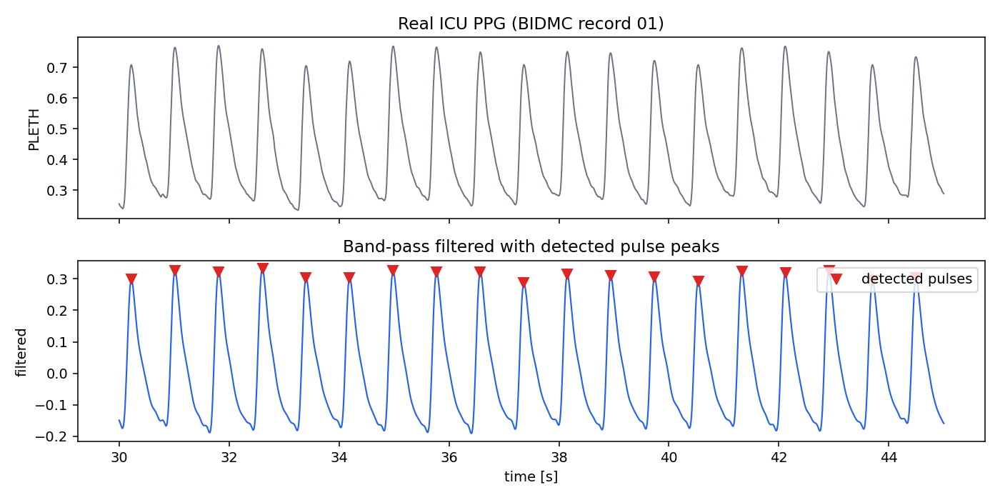
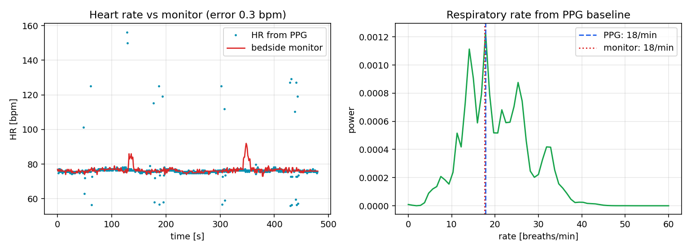
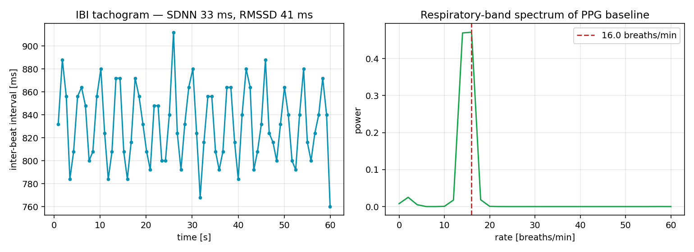

# Vital Signs from a PPG Signal

A training project in biosignal processing. Heart rate, heart-rate variability and breathing rate from one optical pulse signal, compared with a hospital bedside monitor.



The light sensor in a smartwatch or pulse oximeter is a photoplethysmograph (PPG): it sees each heartbeat as a small change in reflected light. The script loads an 8-minute intensive-care recording (BIDMC record 03, PhysioNet, 125 Hz), band-pass filters the PPG, and detects every pulse. Heart rate and HRV (SDNN, RMSSD) come from the intervals between pulses. Breathing rate comes from the slow rise and fall of pulse height, read from its spectrum. The bedside monitor's own heart-rate and breathing values are kept aside and used only for comparison at the end.





This is one record from one patient, used for practice; the numbers in `metrics.txt` describe this recording only.

## Run

```bash
pip install -r requirements.txt
python ppg_vitals.py
```

## Data

BIDMC PPG and Respiration Dataset, record 03 (PhysioNet). Please cite Pimentel, M.A.F. et al., "Towards a Robust Estimation of Respiratory Rate from Pulse Oximeters," IEEE Transactions on Biomedical Engineering, 2016, and Goldberger, A. et al., "PhysioBank, PhysioToolkit, and PhysioNet," Circulation, 2000.

---

Yaşar Aykut Altuntop · Koç University · [LinkedIn](https://linkedin.com/in/aykutaltuntop) · [GitHub](https://github.com/Aykut0)
